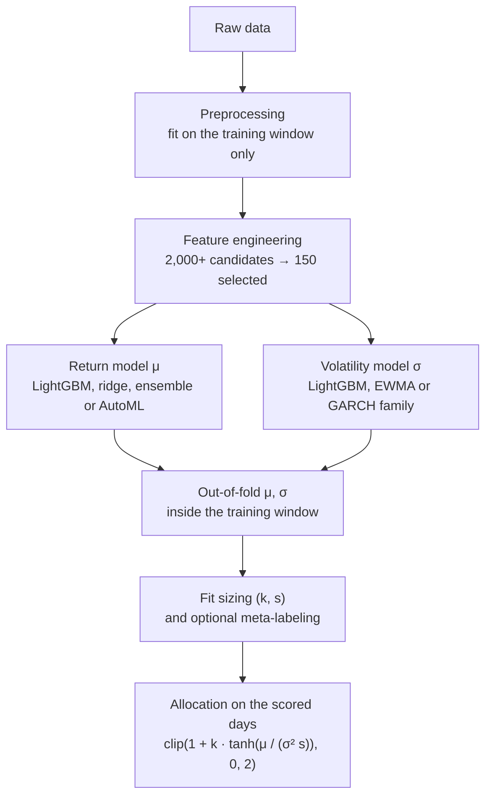

# Project Documentation

Technical reference for the pipeline. Results and the summary are in the [README](README.md).

## Pipeline



Each configuration is run on every development fold by `src/pipeline.py`:

1. **Features** are fitted on the fold's training rows and applied to one contiguous frame (training rows, then the scored rows), so rolling windows in the scored window see their real history.
2. **Out-of-fold predictions.** The last 40% of the training window is cut into 4 chunks. Each chunk is predicted by return and volatility models fitted only on rows before it.
3. **Sizing** (tilt sizes per regime and the tanh scale) is chosen by grid search on those out-of-fold predictions. Meta-labeling, if enabled, is trained on the same rows.
4. The return and volatility models are **refitted on the whole training window** and used to allocate on the scored rows.

No step sees the labels of the rows being scored.

## Validation (`src/preprocessing.py`, `experiments.py`)

- **Lockbox.** The last 500 trading days are excluded from every development fold and were scored once, with the configuration chosen beforehand (`python experiments.py --lockbox NAME`; the script refuses to score twice).
- **Walk-forward development folds.** 5 expanding windows over the remaining data, the first training on 30% of it, each scoring the next ~746 days.
- **Purging.** The training row just before a scored window is dropped, because its 1-day label overlaps the window. Training never follows a scored window, so no embargo is needed.
- **Early stopping** for every LightGBM model uses the last 20% of its own training window (`src/boosting.py`), then the model is refitted on the whole window with the chosen number of rounds.
- **Hyperparameter tuning** (`tune.py`) is nested: Optuna scores each trial on out-of-fold predictions inside the training window; each fold's scored days are used once, after the search.
- **Ledger.** Every configuration run is logged to `results/experiments.csv`; the Deflated Sharpe Ratio uses all of them.

## Labels

`market_forward_excess_returns`, the competition target, is the forward excess return minus its rolling 5-year mean. A position earns `forward_returns - risk_free_rate`, so that is what the return model predicts, what meta-labels are built from and what all metrics use. Lags of the competition target are still used as features.

## Preprocessing (`src/preprocessing.py`)

- Rows before the point where at most 10% of features are missing are dropped (3,217 of 9,048 rows).
- `E7` (>70% missing) and `I9` (duplicate of `I5`) are dropped.
- Missing values are imputed with training-window medians; availability masks are added for 8 late-starting features.
- Winsorization with MAD bounds fitted on the training window (2.5x, 3x or 4x MAD per feature, from the EDA notebook).

## Feature engineering (`src/features.py`)

- **Temporal:** lags (1, 5), rolling mean, std, min and max (5, 21, 63 days), EMAs (10, 20, 50), extended rolling means (10, 42, 126). All use data up to the previous day.
- **Volatility:** rolling volatility of past returns (5 to 126 days), EWMA volatility, volatility of volatility, absolute and squared returns.
- **Regime:** terciles of 21-day realized volatility, with thresholds fitted on the training window.
- **PCA per correlation cluster** (|r| > 0.95, 85% of variance).
- **Fractional differencing** (d = 0.2 to 0.5); near-duplicate orders are dropped.
- **Selection:** top 80 by LightGBM gain, then squares and pairwise interactions of the top 20, then the top 150 by gain.

## Return models (`src/returns.py`)

| Key | Model |
|---|---|
| `lgbm` | LightGBM, 31 leaves, learning rate 0.05 |
| `lgbm_reg` | LightGBM with 7 leaves, depth 3, learning rate 0.02, 200 samples per leaf, L2 = 10, half the features per tree |
| `ridge` | Standardized ridge regression, penalty chosen by cross-validation |
| `ensemble` | Mean of `lgbm` and `ridge` |
| `automl` | FLAML search (LightGBM, XGBoost, random forest, extra trees, elastic net), 30 s per fit, time-ordered holdout |
| `constant` | Training mean: no return view, so the allocation only times volatility |

## Volatility models (`src/volatility.py`)

| Key | Model |
|---|---|
| `lgbm` | LightGBM on log squared residuals of the return model. exp(E[log e²]) underestimates the variance, so predictions are rescaled to the mean squared residual on the training rows, clipped to the training 10th to 90th percentiles and EWMA-smoothed (λ = 0.9) |
| `ewma` | RiskMetrics, λ = 0.94 |
| `garch` | GARCH(1,1), Student-t errors |
| `gjr` | GJR-GARCH(1,1,1), Student-t errors (asymmetric response to falls) |
| `egarch` | EGARCH(1,1,1), Student-t errors |

GARCH parameters are estimated on the training rows and held fixed while the variance recursion runs through the scored rows.

## Allocation (`src/allocation.py`)

```
allocation = clip(1 + k[regime] · tanh(μ / (σ² · s)) · m, 0, 2)
```

- `μ / σ²` is the Kelly fraction; tanh bounds it.
- `1` is the neutral position (buy-and-hold). With `k = 0` the strategy is buy-and-hold.
- `k` is chosen per volatility regime (or one `k` for all with `regime_dependent=False`) from {0, 0.25, 0.5, 0.75, 1} and `s` from {0.5, 1, 2, 4, 8, 16}, maximizing the Sharpe ratio on the out-of-fold predictions.
- `m` is the meta-labeling multiplier (1 without meta-labeling).

## Meta-labeling (`src/meta_labeling.py`)

- Label: 1 if the sign of the predicted excess return matched the realized one.
- Features: the model features plus |μ|, sign(μ) and the rolling volatility of past predictions.
- Trained on the out-of-fold predictions (in-sample predictions make the primary model look far more accurate than it is).
- The tilt is multiplied by `P(correct) / base rate`, clipped to [0, 2], so confident days get a larger tilt and the average tilt is unchanged.

## Metrics (`src/metrics.py`)

- **Sharpe ratio:** annualized mean over standard deviation of daily excess returns `allocation × (forward_returns - risk_free_rate)`.
- **Competition score:** reimplementation of the Hull Tactical metric: Sharpe ratio from the geometric mean excess return, divided by a volatility penalty (above 1.2x market volatility) and a quadratic return-shortfall penalty.
- **Maximum drawdown** of the compounded excess-return curve.
- **Deflated Sharpe Ratio** (Bailey and López de Prado, 2014): probability that the true Sharpe ratio exceeds the best one expected from N unskilled trials, given the spread of the trials' Sharpe ratios, sample length, skewness and kurtosis. It is reported against 0 and against buy-and-hold (benchmark = buy-and-hold Sharpe + the trials haircut).
- **Sharpe difference interval:** circular block bootstrap (20-day blocks) of strategy minus buy-and-hold, resampling the same days for both.
- **QLIKE** for volatility forecasts: mean of log σ² + e² / σ².

## Scripts

| Script | What it does |
|---|---|
| `experiments.py` | Runs configuration groups on the development folds, logs to the ledger, prints the summary and DSR; `--lockbox NAME` scores the lockbox once |
| `tune.py` | Nested Optuna search for the LightGBM return model, logged to the ledger. `FINAL_CONFIG` (`tune_trials=50`) runs the same search inside `evaluate.py`, `train.py` and the lockbox run |
| `evaluate.py` | Per-fold metrics of `FINAL_CONFIG` vs buy-and-hold, written to `evaluation_results.csv` |
| `train.py` | Fits `FINAL_CONFIG` on all data and saves it to `models/` |
| `plots.py` | Figures in `results/figures/` |

## Reproducibility

- Seed 42 for NumPy, LightGBM, Optuna and FLAML. FLAML's search is time-budgeted, so AutoML results vary slightly between machines.
- Engineered features per fold are cached in `results/cache/` (they do not depend on the configuration). Delete the folder after changing `src/features.py` or `src/preprocessing.py`.
- A full run of all experiment groups takes about 30 minutes on a 12-core laptop, most of it AutoML.
