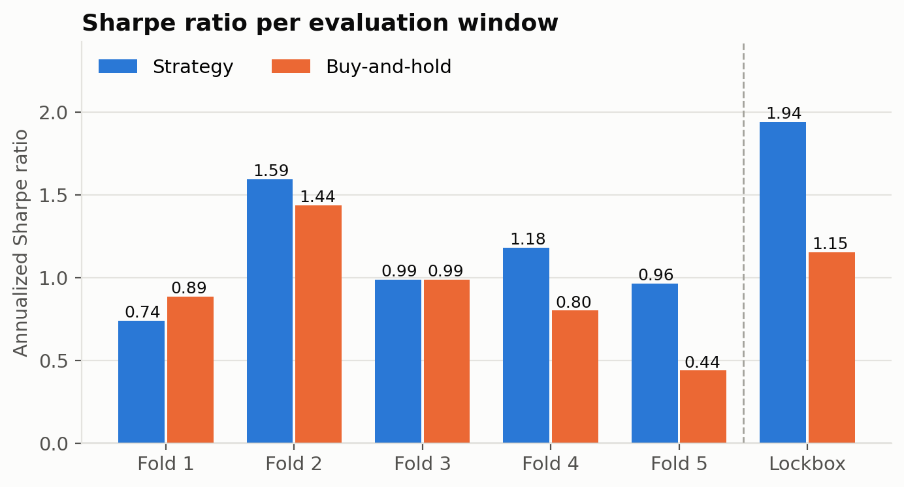
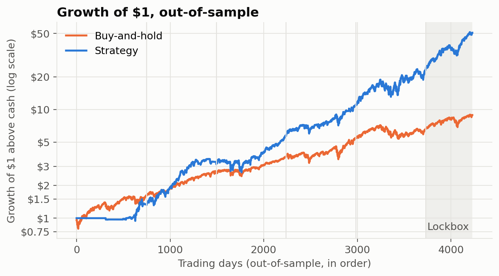
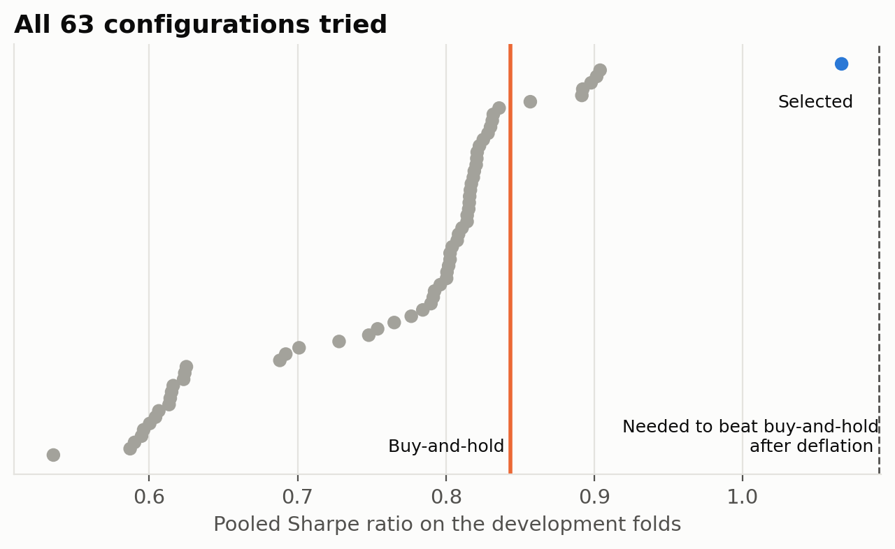
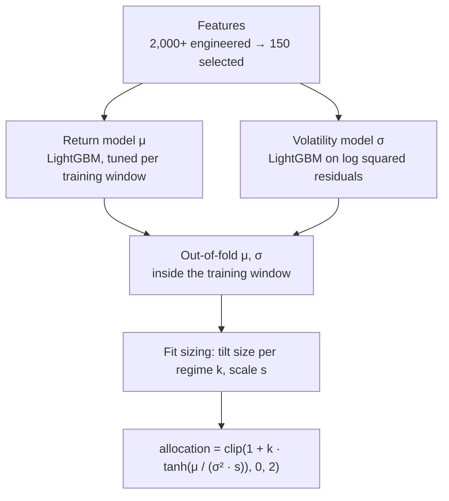

# Daily S&P 500 Allocation, Validated Against Buy-and-Hold

[](https://www.python.org/)
[](https://lightgbm.readthedocs.io/)

My solution for the [Hull Tactical Market Prediction](https://www.kaggle.com/competitions/hull-tactical-market-prediction/) Kaggle competition (2025). Each day the model decides how much capital to put into the S&P 500, from 0% to 200%. The project is as much about measuring the result honestly as about the model: 63 configurations were compared on walk-forward folds, the best was chosen by a rule fixed in advance, and the last two years of data were held out and scored once.

**Result:** on the last 500 trading days, never used during development, the strategy had a Sharpe ratio of **1.94** against **1.15** for buy-and-hold. Over all 4,230 out-of-sample days it was **1.17** against **0.88**. The edge is consistent but not statistically conclusive: the 95% interval for the Sharpe difference is -0.03 to +0.63 over all out-of-sample days, and after deflating for the 63 configurations tried, the probability that it beats buy-and-hold is 46% on the development folds.



## Results

| Window | Days | Sharpe | Buy-and-hold | Competition score | Buy-and-hold | Max drawdown | Buy-and-hold |
|---|---|---|---|---|---|---|---|
| Fold 1 | 746 | 0.74 | 0.89 | 0.47 | 0.78 | 14.0% | 17.4% |
| Fold 2 | 746 | 1.59 | 1.44 | 1.01 | 1.38 | 15.3% | 9.7% |
| Fold 3 | 746 | 0.99 | 0.99 | 0.54 | 0.92 | 24.3% | 12.9% |
| Fold 4 | 746 | 1.18 | 0.80 | 1.08 | 0.70 | 20.8% | 23.9% |
| Fold 5 | 746 | 0.96 | 0.44 | 0.53 | 0.35 | 30.5% | 24.9% |
| **Development (pooled)** | 3,730 | **1.07** | 0.84 | | | 30.5% | 24.9% |
| **Lockbox** | 500 | **1.94** | 1.15 | **1.37** | 1.08 | 19.5% | 18.6% |

Sharpe ratios are annualized, on excess returns over the risk-free rate. The competition score is my reimplementation of the competition metric (Sharpe ratio divided by penalties for volatility above 1.2x the market and for underperforming it).



What the numbers do and don't say:

- **Not significant.** The 95% block-bootstrap interval for the Sharpe difference against buy-and-hold is -0.12 to +0.59 on the development folds, -0.06 to +1.59 on the lockbox and -0.03 to +0.63 over both. The Deflated Sharpe Ratio against buy-and-hold is 0.46 on the development folds (63 configurations): a 46% probability of beating it, where 95% is the usual bar.
- **Higher risk.** The strategy averages 123% invested on the development folds and mostly takes all-in or all-out positions. Annualized volatility is 22% against 16% for buy-and-hold, and its worst drawdown is deeper (30.5% against 24.9%).
- **The competition metric penalizes that risk.** On folds 1 to 3 the strategy's competition score is below buy-and-hold's even where its Sharpe ratio is equal or higher. It is above buy-and-hold on folds 4, 5 and the lockbox.
- **Transaction costs** are not in the headline numbers. The allocation changes by 0.3 (development) to 0.5 (lockbox) of capital per day on average. At 5 basis points per unit traded, the Sharpe ratio falls from 1.07 to 0.89 (development) and from 1.94 to 1.65 (lockbox).
- **Directional accuracy** is 51.2% on the development folds and 56.8% on the lockbox.

## What was tried



Every configuration is logged in [`results/experiments.csv`](results/experiments.csv). Pooled Sharpe ratio on the development folds (buy-and-hold: 0.84):

| Return model | LightGBM volatility | EWMA | GARCH | GJR-GARCH | EGARCH |
|---|---|---|---|---|---|
| None (volatility timing only) | 0.79 | 0.83 | 0.82 | 0.82 | 0.80 |
| LightGBM, default | 0.62 | 0.62 | 0.59 | 0.61 | 0.60 |
| LightGBM, strongly regularized | 0.90 | 0.89 | 0.90 | 0.90 | 0.89 |
| Ridge | 0.73 | 0.83 | 0.83 | 0.81 | 0.80 |
| LightGBM + ridge | 0.69 | 0.82 | 0.79 | 0.83 | 0.82 |
| **LightGBM, nested Optuna tuning** | **1.07** | | | | |

Plus a single tilt size for all volatility regimes (25 configurations), meta-labeling (10) and FLAML AutoML (2, best 0.86). Findings:

- **The default LightGBM loses to buy-and-hold.** Only heavier regularization or tuning gets ahead of it.
- **Volatility timing alone does not beat buy-and-hold.** Scaling exposure by forecast volatility, with no return view, scored 0.78 to 0.83 across the 10 variants.
- **GARCH-family models forecast volatility better** than the LightGBM volatility model (lower QLIKE: about -8.42 against -8.23), but that did not translate into a higher Sharpe ratio.
- **Meta-labeling did not help.** Trained on out-of-fold predictions, the classifier's probabilities stayed between about 0.48 and 0.57, too close to the base rate to resize positions meaningfully.

## How it works



1. **Return model.** LightGBM regression of the next day's excess return. Its hyperparameters are tuned per training window with Optuna (50 trials), scoring each trial on out-of-fold predictions inside that window.
2. **Volatility model.** LightGBM regression of the log squared residuals of the return model, rescaled to the mean squared residual (the log transform biases it low), clipped and EWMA-smoothed.
3. **Allocation.** Fractional Kelly (μ / σ²) bounded with tanh around a neutral 100% position, with a tilt size per volatility regime (terciles of trailing 21-day volatility). Tilt sizes and scale are fitted on out-of-fold predictions from the training window. A tilt of 0 is buy-and-hold, so the fit can always fall back to it.

More detail in [`DOCUMENTATION.md`](DOCUMENTATION.md).

## Validation

- **Lockbox.** The last 500 trading days were excluded from all development and scored once with the configuration chosen beforehand. The script refuses to score them twice.
- **Walk-forward folds.** 5 expanding windows over the remaining data, each scoring the next ~746 days. The training row whose label overlaps the scored window is purged.
- **Nothing tuned on scored days.** Early stopping uses the end of each training window; tuning, sizing and meta-labeling use out-of-fold predictions inside it.
- **Contiguous history.** Rolling features on scored days are computed with the real preceding data, not restarted at the window boundary.
- **Selection rule fixed in advance:** the highest pooled Sharpe ratio on the development folds.
- **Deflated Sharpe Ratio** (Bailey and López de Prado) over every configuration in the ledger, against zero and against buy-and-hold, and a block bootstrap of the Sharpe difference.

### Leaks found along the way

A review of the pipeline found four leaks, all fixed in this version:

- The allocator's volatility regime was computed from a rolling window that included the day being traded, with thresholds taken from the whole scored window.
- Early stopping and hyperparameter tuning used the scored fold.
- The meta-labeling classifier was trained on in-sample predictions, where the return model looks far more accurate than it is.
- Rolling features restarted at the start of each scored window, so its first ~100 days had incomplete features.

It also found that the volatility model predicted σ about 2x too low (the log-variance bias above).

## Quick start

```bash
python -m venv .venv && source .venv/bin/activate
pip install -r requirements.txt
```

The competition rules don't allow redistributing the data. Download `train.csv` from the [competition data page](https://www.kaggle.com/competitions/hull-tactical-market-prediction/data) and place it in `data/`.

```bash
python experiments.py              # all configurations on the development folds (~30 min)
python tune.py --vol-model lgbm    # nested tuning (~6 min)
python experiments.py --summary    # ledger, best configuration, Deflated Sharpe Ratio
python evaluate.py                 # final configuration, per fold vs buy-and-hold
python train.py                    # fit the final configuration on all data
python plots.py                    # figures
```

See [`QUICKSTART.md`](QUICKSTART.md) for subsets and the lockbox command.

## Project structure

```
.
├── experiments.py        # configuration groups, ledger, DSR summary, lockbox
├── tune.py               # nested Optuna tuning
├── evaluate.py           # final configuration vs buy-and-hold per fold
├── train.py              # fit on all data, save to models/
├── plots.py              # figures
├── evaluation_results.csv
├── results/              # ledger, lockbox score, figures
├── src/
│   ├── config.py         # all constants, FINAL_CONFIG
│   ├── preprocessing.py  # cleaning, winsorization, folds and lockbox
│   ├── features.py       # feature engineering and selection
│   ├── pipeline.py       # one configuration on one fold
│   ├── returns.py        # return models
│   ├── volatility.py     # LightGBM, EWMA and GARCH-family volatility
│   ├── allocation.py     # regime-dependent Kelly sizing
│   ├── meta_labeling.py  # meta-labeling classifier
│   ├── tuning.py         # nested Optuna search
│   ├── boosting.py       # LightGBM with early stopping inside the training window
│   └── metrics.py        # Sharpe, competition score, DSR, bootstrap
├── notebooks/eda.ipynb   # exploratory analysis
├── data/                 # train.csv goes here (not included)
└── models/               # final fitted model (generated)
```

## References

- Marcos López de Prado, *Advances in Financial Machine Learning* (Wiley, 2018): purged cross-validation, meta-labeling.
- David H. Bailey and Marcos López de Prado, "The Deflated Sharpe Ratio" (*Journal of Portfolio Management*, 2014).

## Author

Marcos Saade · [marcossaade.github.io](https://marcossaade.github.io) · [LinkedIn](https://www.linkedin.com/in/marcos-saade/)
