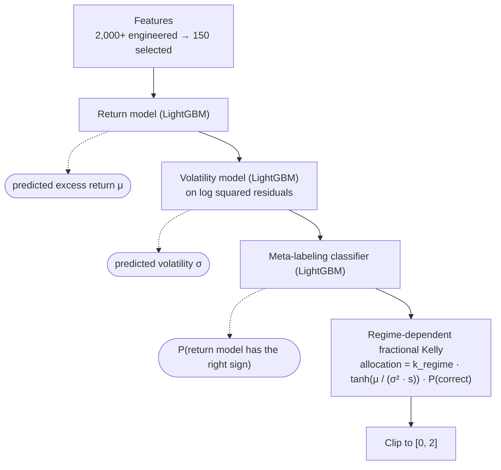

# Daily S&P 500 Allocation with Meta-Labeling

[](https://www.python.org/)
[](https://lightgbm.readthedocs.io/)

My solution for the [Hull Tactical Market Prediction](https://www.kaggle.com/competitions/hull-tactical-market-prediction/) Kaggle competition (2025). Each day the model decides how much capital to put into the S&P 500, from 0% to 200%, to maximize risk-adjusted excess returns.

**Result:** a mean annualized Sharpe ratio of **1.49** across 5 purged, time-ordered validation folds (range 0.99 to 1.88). For comparison, buy-and-hold over recent 800-day windows has a Sharpe ratio of about 0.54 to 0.82, so the strategy is roughly 2x buy-and-hold over comparable periods. See [Results](#results) for the caveats.

## How it works



1. **Return model.** LightGBM regression of next-day excess return.
2. **Volatility model.** LightGBM regression of the log squared residuals of the return model, then bias-corrected, clipped to the 10th to 90th percentile of training and EWMA-smoothed.
3. **Meta-labeling.** A LightGBM classifier predicts whether the return model's sign is correct, and the position is scaled by that probability.
4. **Allocation.** Fractional Kelly sizing with a tanh soft cap, and a Kelly fraction that depends on the volatility regime:

   | Volatility regime | Percentile of predicted volatility | Kelly fraction k |
   |---|---|---|
   | Low | below 33rd | 0.99 |
   | Medium | 33rd to 66th | 0.71 |
   | High | above 66th | 0.50 |

## Validation

Financial time series leak easily, so validation was the part I was most careful with:

- **Expanding-window, purged K-fold CV** (5 folds, first fold trains on 30% of the data). Samples whose labels overlap the validation window are purged.
- **Embargo** of 1% of validation samples after each fold to limit serial-correlation leakage.
- **Fold-local preprocessing.** Medians for imputation, MAD-based winsorization bounds and feature selection are all fit on the training part of each fold only.
- **Feature selection.** Rolling statistics, momentum, lags, several volatility estimators and regime interactions produce 2,000+ candidates. Correlation clustering with PCA per cluster (85% variance) removes redundancy, and the top 150 by LightGBM importance are kept.

## Results

From [`evaluation_results.csv`](evaluation_results.csv) (800 trading days per fold):

| Fold | Sharpe (base) | Sharpe (with meta-labeling) | Directional accuracy |
|---|---|---|---|
| 1 | 1.32 | 1.32 | 49.0% |
| 2 | 1.81 | 1.81 | 52.9% |
| 3 | 1.88 | 1.85 | 52.9% |
| 4 | 0.99 | 0.99 | 53.3% |
| 5 | 1.47 | 1.43 | 53.5% |
| **Mean** | **1.49** | **1.48** | **51.7%** |

What the numbers do and don't say:

- These are plain annualized Sharpe ratios from my evaluation script, not the competition's penalty-adjusted score, and they come from validation folds, not a live leaderboard.
- Transaction costs are not modeled.
- The competition obfuscates dates, so the buy-and-hold comparison uses comparable recent windows of the S&P 500 (2009 to 2025, excess return over T-bills) rather than the exact fold dates. It is an approximate comparison.
- **Meta-labeling did not help.** It changed the Sharpe ratio by less than 1% on average (between -2.8% and +0.7% per fold). It shrinks positions by about 40%, which lowers volatility and mean return about equally. I kept it in the pipeline because it is cheap to disable (`--no-meta`), but the edge comes from the return and volatility models and the sizing rule.
- Directional accuracy is only slightly above 50%. Most of the edge comes from sizing positions by predicted return and volatility, not from calling direction.

## Quick start

```bash
python -m venv venv
source venv/bin/activate        # Windows: venv\Scripts\activate
pip install -r requirements.txt
```

The competition rules don't allow redistributing the data. Download `train.csv` from the [competition data page](https://www.kaggle.com/competitions/hull-tactical-market-prediction/data) and place it in `data/`.

```bash
python train.py --stage all          # preprocess, build CV folds, train all models
python evaluate.py                   # writes evaluation_results.csv
python evaluate.py --no-meta         # same, without meta-labeling
```

Other options:

```bash
python train.py --stage returns --folds 1,2   # one stage, selected folds
python train.py --stage all --force           # ignore cached folds and models
python tune.py --stage returns --n-trials 100 # Optuna tuning (all | returns | volatility | meta)
python evaluate.py --fold 3                   # single fold
```

Stages depend on each other: volatility uses the return model's residuals, and meta-labeling uses its predictions. After retraining the return model, retrain the other two.

## Project structure

```
.
├── train.py              # training orchestration (--stage, --folds, --force)
├── evaluate.py           # per-fold Sharpe and directional accuracy
├── tune.py               # Optuna hyperparameter search
├── evaluation_results.csv
├── src/
│   ├── config.py         # all constants: CV, features, model and allocation parameters
│   ├── preprocessing.py  # cleaning, winsorization, purged CV folds
│   ├── features.py       # feature engineering and selection
│   ├── returns.py        # return model
│   ├── volatility.py     # volatility model
│   ├── meta_labeling.py  # meta-labeling classifier
│   └── allocation.py     # regime-dependent Kelly sizing
├── notebooks/eda.ipynb   # exploratory analysis
├── data/                 # train.csv goes here (not included)
└── models/               # trained models per fold (generated)
```

More detail in [`DOCUMENTATION.md`](DOCUMENTATION.md) and [`QUICKSTART.md`](QUICKSTART.md).

## References

The validation and meta-labeling approach follows Marcos López de Prado, *Advances in Financial Machine Learning* (Wiley, 2018).

## Author

Marcos Saade · [marcossaade.github.io](https://marcossaade.github.io) · [LinkedIn](https://www.linkedin.com/in/marcos-saade/)
